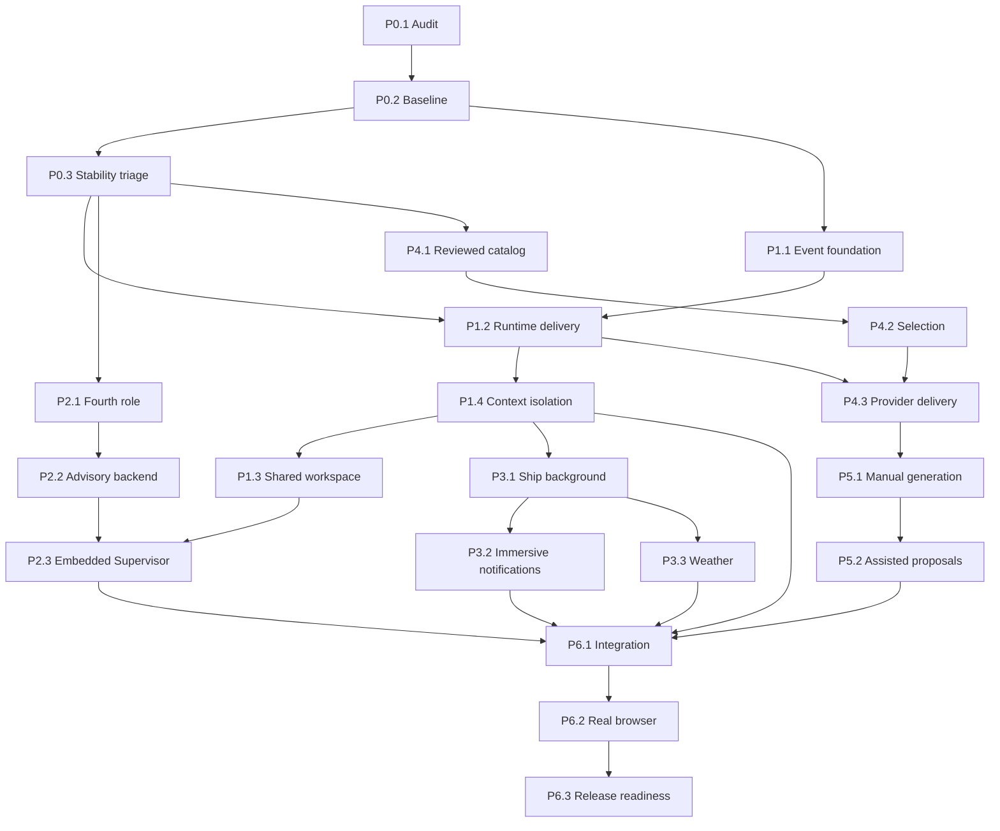

# Planwharf implementation coordination

Authoritative contract: `spec/Task planwharf.txt` (1,315 lines). Requirements and exact acceptance traceability: `requirements.md`. This plan is subordinate to that contract. Product delivery is unfinished.

User browser steering on 2026-10-16: do not use Edge on this laptop. Use Chrome only for current browser tests; a real successful Chrome run is reported PASS in Chrome. Keep product code browser-neutral. Other browser engines remain unverified and do not block acceptance of this bounded Chrome validation increment.

## Baseline and boundaries

Public upstream was read on 2026-10-16: `d3fae01fa183b00780620dd47a0598f28c9058a6`. A fresh isolated checkout at `repository/` starts detached at that revision, with a clean working tree, no local product data, and only origin `https://github.com/benitz94/Planwharf.git`. Its initial log ends with `Add full-background sailing harbor and Supervisor monitoring`. Initial diff is empty. Owner path `D:\benit\Desktop\Projects\Planwharf` is unavailable; its HEAD, dirty changes, data and running processes cannot be audited here. Never substitute this clone's state for the owner's state.

The separate Rocco contribution `fix/provider-account-catalog-isolation`, commit `99fe5867b3d04af4fa3a22b604b595188cbb26b1`, is not imported. Do not overwrite, cherry-pick, or assume it is upstream. P0 records actual provider-account code and test results; any overlapping repair requires an explicit overlap review and separate task.

No commits, pushes, publication, releases, CLA acceptance, history rewrite or visibility changes without subsequent explicit human authorization. No destructive checkout/reset/clean. Never touch `sources/`, unrelated Specials files, personal notebooks, credential stores or existing workers. No global skill installation, imported hooks, scripts, daemons, broad new privileges, or silent provider substitution. Live model calls require explicit authorization and quota; ordinary observation stays deterministic.

## Assignment protocol

The coordinator owns this plan, tracker, locks and integration checkout. Each task has one implementing worker and a different reviewer. Reviewers read the full relevant specification and verify behavior, provenance and test evidence; a worker's final message is not acceptance. A reviewer reports PASS, CHANGES REQUESTED or BLOCKED, with file/line findings and exact reproduction. Reviewer never self-approves implementation.

All implementation tasks use a unique `coord/<task-id>` branch and `worktrees/<task-id>/` checkout from the recorded integration revision. The first increment uses `coord/p1-activity` in `worktrees/p1-activity`. Branch creation does not authorize commits. Because all changes must stay uncommitted, later tasks cannot inherit an earlier worker's branch tip as proof of integration: the coordinator applies a reviewed patch to the integration checkout, records file hashes, and seeds dependent worktrees with that exact patch set. Keep patches and hashes outside product code. Never assume an uncommitted patch exists in another worktree.

Before starting: read AGENTS.md, status/log/diff/remotes, relevant spec sections, dependency receipts and baseline tests. Claim the exact file allowlist in the tracker before editing. New files need coordinator approval of ownership, not another user authorization. Any task needing a held file waits; never allow simultaneous edits even across separate worktrees where integration would obscure ownership. Shared UI, server and orchestrator files are explicitly serialized. Workers may not expand scope to make tests green. Preserve unrelated changes.

Each task receipt includes task ID, base SHA plus integration patch hashes, files read/changed, exact commands and exit codes, counts with denominator, fixture versus live scope, baseline comparison, reviewer disposition, patch hash, residual risks and next dependency. Redact secrets, preserve original local evidence under access boundaries, and do not publish raw user logs.

## Dependency DAG and waves

Wave 0 runs audit, traceability and safe baseline independently. Wave 1 implements and reviews only the activity foundation. Later waves unlock from actual dependency evidence, not calendar dates. P2 backend and P4 catalog may run beside workspace work only if their exact file locks are disjoint. P2 role migration must be integrated before dependent server/UI changes; shared files always serialize. P3 weather may develop independently in a new module once background contracts are stable, then integrate serially. P5 follows proven skill delivery. P6 is a gate, never a cleanup label that implies success.

## Bounded task contracts

Files listed are intended allowlists verified against actual architecture. Tests may add only task-specific named test files agreed in the tracker. If audit finds a required path differs, coordinator revises the allowlist before dispatch. No task owns a wildcard directory.

| ID | Deliverable and stop boundary | Prerequisites | Intended owned files | Acceptance gate |
| --- | --- | --- | --- | --- |
| P0.1 | Architecture and data-flow audit; no product edits | None | `audit.md`, baseline evidence | Inspect every spec section 1 path and adapter/permission/skills/test/docs boundary; classify functional/partial/missing |
| P0.2 | Repeatable fixture baseline and browser feasibility | P0.1 safety review | baseline evidence only | Exact command/log per file; historical provider-accounts line 84 checked or explicit pre-assertion blocker |
| P0.3 | Repair only established stability defects prerequisite to later phases | P0.2 | Exact files allocated per reproduced defect | Original reproduction fails on base and passes after; no new failures; Rocco overlap reviewed |
| P1.1 | Provider-aware event foundation using existing activity translator | P0.2 focused baseline | `engine/activity.cjs`, `engine/activity-events.cjs`, `engine/activity-events.test.cjs` | Explicit capability/provenance, unknown fallback, bounded redaction, tool completion never validated success; original tests pass |
| P1.2 | Feed real adapter events into per-assignment retained sessions | P0.3, P1.1 | `engine/runner.cjs`, `engine/provider-runtime.cjs`, `engine/external-adapters.cjs`, `engine/orchestrator.js` | Verified adapter-specific protocols; plain-only providers honestly limited; role/provider/model/project/task/time/exit/result state; bounded history |
| P1.3 | Single terminal-friendly operational workspace and Friendly/Technical control | P1.2, P1.4 | `orchestrator.html`, `index.html`, `orch.js`, `window-ui.js`, `layout-ui.js`, `styles.css` | Preserve conversation, unsent input, output, resize/focus/keyboard/scroll/preferences/light theme; all roles accessible without redundant pages |
| P1.4 | Project context and simultaneous-assignment isolation before UI integration | P1.2 | `engine/orchestrator.js`, `engine/conversation-history.cjs` if confirmed, `orch.js`, `home-ui.js` | Two projects prove no conversation/approval/result/checkpoint/skill/report crossover; quotas may remain shared; repeat after UI integration |
| P2.1 | Explicit opt-in Supervisor role with legacy/account migration | P0.3 | `engine/model-roles.cjs`, `engine/provider-models.cjs`, `models.js`, `model-policy-ui.js`, `engine/model-roles.test.cjs` | Old three roles unchanged, new role false by default, persisted identity/filter/eligibility/quota behavior |
| P2.2 | Deterministic Core and bounded read-only advisory AI | P2.1 | `engine/supervisor.cjs`, `server.cjs`, `engine/orchestrator.js`, `engine/supervisor.test.cjs` | No model needed for Core; no dispatch/write/shell/approval authority; auto off, usage recorded, no substitution, safe restart and quota enforcement |
| P2.3 | Embed Supervisor monitoring, settings and questions | P2.2, P1.3 | `supervisor-ui.js`, `supervisor.css`, `orch.js`, `orchestrator.html`, `index.html` | All workers/reviewers, anomalies and evidence linked; inert editable name, exact blank fallback Supervisor, never hardcode Jack Sparrow |
| P3.1 | Reuse full-window ship background and backend state mapping | P1.4 | `harbor-ui.js`, `harbor.css`, `index.html`, `orchestrator.html` | No widget layout/focus/pointer disruption; all five flags preserved; completion requires real backend completion and no relevant live workers |
| P3.2 | Ship View preservation and fact-based notifications | P3.1 | `harbor-ui.js`, `harbor.css`, `notifications.js`, `orch.js`, `window-ui.js` | Entry/exit retains input/layout/selection/scroll/sessions; idle works; seven notification classes, density controls never suppress critical alerts; relevant context return |
| P3.3 | Adaptive, Random and Manual decorative weather | P3.1 | new `ship-weather.js`, `harbor-ui.js`, `harbor.css` | Planning-based bounded complexity; gradual random intervals; manual visual only; reduced/off/OS motion and hidden-tab throttle; no health/progress inference |
| P4.1 | Selective reviewed source/version/license-aware skill catalog | P0.3 | `engine/skills.js`, `engine/skills.test.cjs` | Matt/ECC/local distinguished; provenance/dependencies/tools/harness/validation stored; deduplicate, refresh preserves choices; no whole ECC runtime |
| P4.2 | Per-project auditable Auto/Manual approved selection | P4.1 | `engine/skills.js`, `server.cjs`, `orch.js`, `index.html` | Search/source filters/per-skill disable, context/role/provider/exclusion-aware reasons; no unapproved download/execution |
| P4.3 | Real delivery and staged evidence to providers and Supervisor | P4.2, P1.2 | `engine/runner.cjs`, `engine/provider-runtime.cjs`, `engine/skills.js`, `engine/supervisor.cjs` | Discovery/enabled/attached/loaded/followed/verified distinct; unsupported native capability explicit; fixtures separate from authorized live proof |
| P5.1 | Project-local draft generation and approval | P4.3 | new `engine/skill-generation.cjs`, `server.cjs`, `orch.js` | Authorized project sources, inspect/edit/approve draft, provenance/revision, activation only after approval, no global promotion |
| P5.2 | Evidence-based assisted suggestions | P5.1 | `engine/skill-generation.cjs`, `engine/supervisor.cjs`, `orch.js` | Repeated validated procedures, bounded low-noise suggestions, approval mandatory; Full Auto disabled, no privilege expansion |
| P6.1 | Integrated lifecycle, isolation, migration, quota and recovery suite | P1.4, P2.3, P3.2, P3.3, P5.2 | task-specific integration tests only | Same-environment baseline comparison; all spec 13.2 cases; zero unexplained new regressions |
| P6.2 | Actual browser acceptance against isolated backend | P6.1 | task-specific browser suite and evidence | All spec 13.3 interactions, two projects, themes/viewports, preference restart, errors/network checked; actual screenshots only |
| P6.3 | Product documentation and final readiness receipt | P6.2 | `README.md`, approved user docs, final evidence | All 25 AC demonstrated or precisely unaccepted; sections A–E delivery, exact status/files, live-provider gap honest; no publication |

## Integration milestones

M0: audit + safe fixture baseline recorded, blockers distinguished. M1: reviewed activity foundation integrates without changing existing UI claims. M2: real event delivery and shared workspace accepted; per-project isolation proven. M3: opt-in fourth role and advisory restrictions accepted. M4: ship/immersive/weather accepted with accessibility. M5: approved selective skills delivered with honest provider evidence and local generation approval. M6: full backend/browser regression evidence and user documentation accepted.

For every milestone, require independent review, exact patch manifest, focused tests and previously affected integration tests. A sandbox denial is BLOCKED, not PASS or a product failure. Retest a bounded failing fixture outside the restriction only with the approved mechanism; keep both receipts. Do not use an in-memory bridge as evidence of working real HTTP/browser behavior.

## Shared progress

`tracker.json` is the machine-readable assignment/lock/evidence ledger; the Work dashboard mirrors accepted milestones and current blockers. Update both after task/reviewer transitions. There is no automatic scheduled continuation or hidden perpetual agent. An idle task needs an explicit dispatch from the coordinator within the authorized scope. Product acceptance remains distinct from coordination artifacts.

## Subsequent publication authorization
User authorized stopping implementation at 18:15 Europe/Berlin on 2026-10-16, then saving all Planwharf work as Rocco for Benito review and home resumption. Dedicated review branch and draft PR authorized; no merge, release or CLA acceptance. Unreviewed work must be saved separately and labelled unaccepted.

